<div align="center">

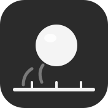

# Bounce Classic

**Keep the ball bouncing.**

A side-scrolling platform game in C++. Roll and jump a ball through three
levels of blocks, spikes and spiders, then put your name on the leaderboard.


[Screens](#screens) ·
[Levels](#levels) ·
[Flows](#flows) ·
[Controls](#controls) ·
[Build and run](#build-and-run)

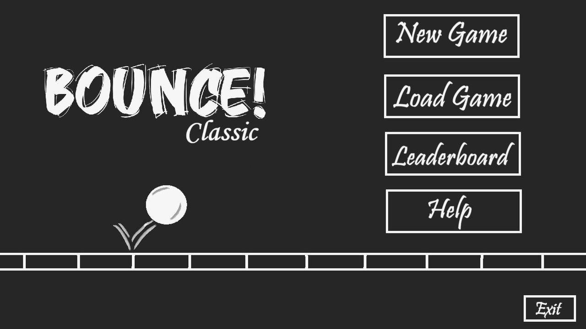

</div>

Bounce Classic is a one-file game, `iMain.cpp`, built on the iGraphics
library. You steer a ball to the right across a scrolling level, jumping onto
and under blocks and dodging spikes and spiders. Health starts at 100 for each
level, the score follows your progress, and the best scores are kept in a
leaderboard file. The game window is titled "Bounce Classico".

## At a glance

| | |
| --- | --- |
| **What it is** | A 2D side-scrolling platformer in C++ on iGraphics (OpenGL, GLUT, SDL2) |
| **Levels** | 3, each with its own blocks, spikes and spiders |
| **Health** | 100 at the start of every level; spikes and spiders cost 10 per tick |
| **Score** | Moving right adds points, moving left takes them away, and it carries across levels |
| **Persistence** | `saved.txt` for one saved game, `leaderboard.txt` for the top scores |
| **Window** | Fixed 1280 x 720 |
| **Platforms** | Linux (`runner.sh`) and Windows (`runner.bat`, MinGW) |

## Contents

- [At a glance](#at-a-glance)
- [Screens](#screens)
- [Levels](#levels)
- [Gameplay](#gameplay)
- [Flows](#flows)
- [Controls](#controls)
- [Menus, saving and the leaderboard](#menus-saving-and-the-leaderboard)
- [Build and run](#build-and-run)
- [Built with](#built-with)
- [Project layout](#project-layout)
- [Notes](#notes)
- [Status](#status)
- [Credits](#credits)

## Screens

These are the game's own menu screens, taken from `assets/images/bg/`. They are
the artwork the game draws, not captures of live play: gameplay needs a display with
OpenGL, which was not available when this README was written.

<table>
<tr>
<td width="50%" valign="top">
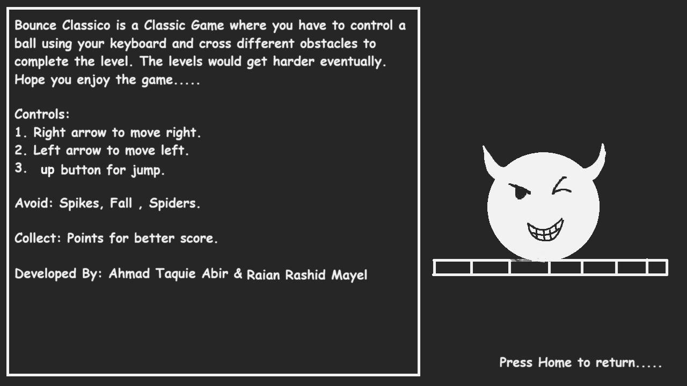
<p><b>Help.</b> The in-game guide to the controls and the goal.</p>
</td>
<td width="50%" valign="top">
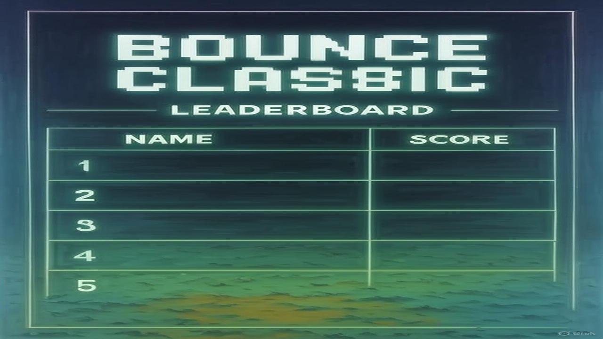
<p><b>Leaderboard.</b> Names and scores, best first. Only the top five are shown.</p>
</td>
</tr>
<tr>
<td width="50%" valign="top">
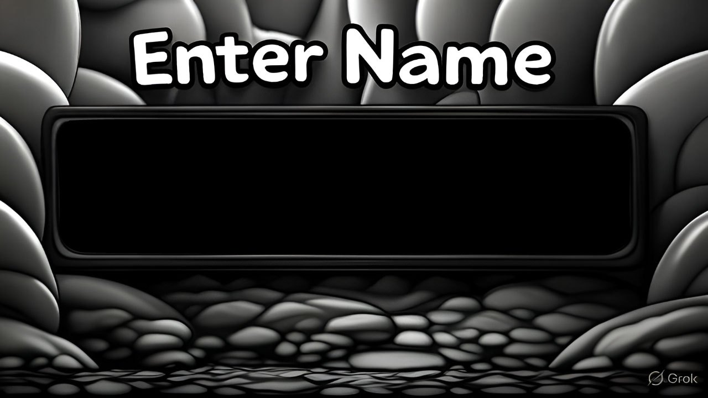
<p><b>Name entry.</b> The backdrop for typing your name after a game over or a finished run.</p>
</td>
<td width="50%" valign="top">

<p><b>Main menu.</b> New Game, Load Game, Leaderboard, Help and Exit, clicked with the mouse.</p>
</td>
</tr>
</table>

## Levels

Each level is one long horizontal map, 10,000 to 13,000 pixels wide, that scrolls past a
1280-pixel window. The strips below are the level maps from `assets/images/levels/`, scaled
down to fit. Upper and lower blocks, spikes and spiders are placed from coordinate tables in `iMain.cpp`.

**Level 1**


**Level 2**

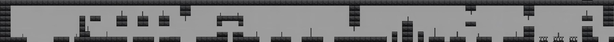

**Level 3**

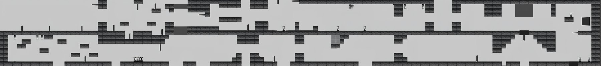

## Gameplay

- The ball rolls across a scrolling level. Move right to progress; jump to get onto or under blocks.
- Each of the three levels has its own layout of upper and lower blocks, spikes and spiders.
- You start every level with 100 health. Touching a spike or a spider costs 10 health per tick, and the game ends when health reaches 0.
- Moving right adds to your score and moving left takes points away.
- Reaching the end of a level moves you to the next one with health refilled. Your score carries over.
- Finish level 3 to see the "Congratulations" screen with your final score.
- After a game over or a finish, you type a name and your score goes to the leaderboard.

## Flows

### Screens

Every screen is one value of the `pressed` variable, and `iDraw()` draws whichever
one is active.

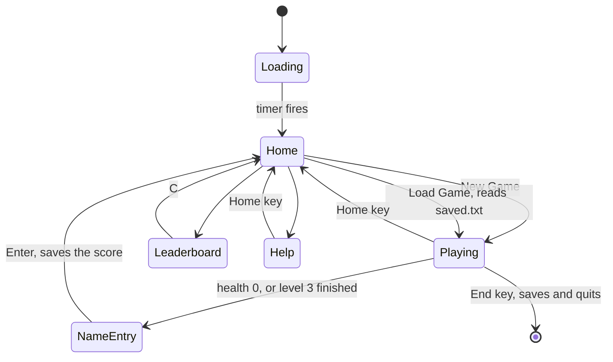

### Level progression

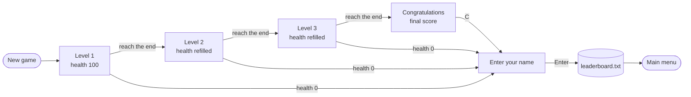

### One frame of play

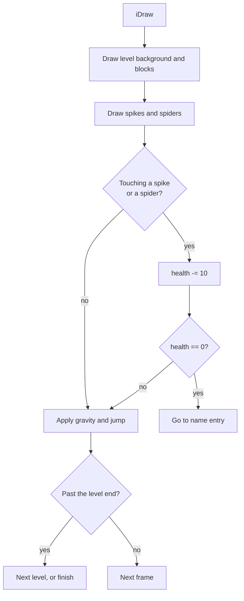

### Saving and the leaderboard

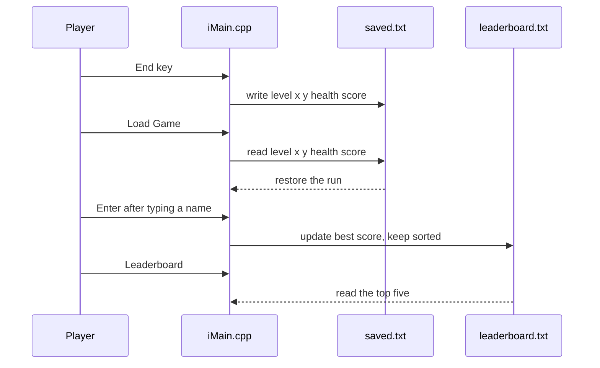

## Controls

| Input | Action |
| --- | --- |
| Left / Right arrow | Move left / right |
| Up arrow | Jump (only while on the ground) |
| Mouse | Click the main menu buttons; click the speaker icon during play to switch sound on or off |
| Home | Return to the main menu |
| End | Save your progress to `saved.txt` and quit |
| C | Continue from the score screen, or leave the leaderboard and game-over screens |
| Letters, space, Backspace, Enter | Type, edit and submit your name |

## Menus, saving and the leaderboard

The main menu has buttons for starting a new game, loading a saved game, the leaderboard and help, plus an exit button.

- **Save and load**: pressing End writes `level x y health score` to `saved.txt`. Load Game reads that file and resumes from it.
- **Leaderboard**: `leaderboard.txt` holds one `Name score` line per player, best first. A player keeps only their best score, and the leaderboard screen shows the top five.
- **Names**: the name prompt asks for a surname. Use a single word, because the leaderboard reads each line as one name followed by one score.

## Build and run

Run all commands from the repository root. The game loads its images, fonts and sounds by relative path (`assets/...`).

### Linux

Install the SDL2, SDL2_mixer, FreeGLUT, FreeType and OpenGL development packages. On Debian or Ubuntu that is roughly:

```bash
sudo apt install build-essential libsdl2-dev libsdl2-mixer-dev freeglut3-dev libfreetype-dev libglu1-mesa-dev
```

Then build and run:

```bash
chmod +x build.sh runner.sh
./runner.sh          # builds iMain.cpp into bin/opengl and starts it
./build.sh           # build only
```

Both scripts take an optional source file as an argument and default to `iMain.cpp`.

### Windows

`build.bat` and `runner.bat` call a MinGW compiler from a folder named `MINGW` next to them. That folder is git-ignored, so it is not in this repository: add a MinGW toolchain there first. The SDL2, FreeGLUT and FreeType DLLs the game needs are already in `bin/`. An `iGraphics.cbp` Code::Blocks project is also included.

## Built with

- **C++** for the whole game, in a single `iMain.cpp`
- **iGraphics** (OpenGL, GLUT) for drawing and input
- **SDL2 and SDL2_mixer** for sound
- **FreeType** for the fonts

## Project layout

```text
.
├── iMain.cpp            The game: setup, drawing, input, collisions, saving and the leaderboard
├── assets/              fonts/, images/ (bg, levels, sprites) and sounds/
├── leaderboard.txt      Top scores, one "Name score" per line
├── saved.txt            Saved game: level x y health score
├── iGraphics.h, iSound.h, iFont.h   iGraphics library headers
├── build.sh, runner.sh  Linux build and run scripts
├── build.bat, runner.bat, release.bat   Windows scripts
├── iGraphics.cbp        Code::Blocks project
├── bin/                 Windows runtime DLLs (and build output)
├── OpenGL/, include/, lib/, libexec/, mingw32/, share/, var/   Bundled headers, libraries and toolchain files from the iGraphics template
└── examples/, tests/    iGraphics demo programs and test scripts
```

Most of the roughly 2,300 tracked files belong to the bundled iGraphics template and toolchain. The game itself is `iMain.cpp` plus `assets/`.

## Notes

- Load Game opens `saved.txt` without checking that it exists, so keep that file in the project folder.
- Names are stored as a single word. A name with a space is not read back correctly from `leaderboard.txt`.
- The window is fixed at 1280 x 720.

## Status

Finished as a university project. The three levels, saving, the leaderboard and the menus all work from the code as written, and the known quirks are listed under Notes.

## Credits

The graphics, input and sound layer is the iGraphics library (v0.6.0 in `iGraphics.h`) by Mahir Labib Dihan, see [github.com/mahirlabibdihan](https://github.com/mahirlabibdihan). Check the upstream project for the library's terms; this repository has no license file of its own.
